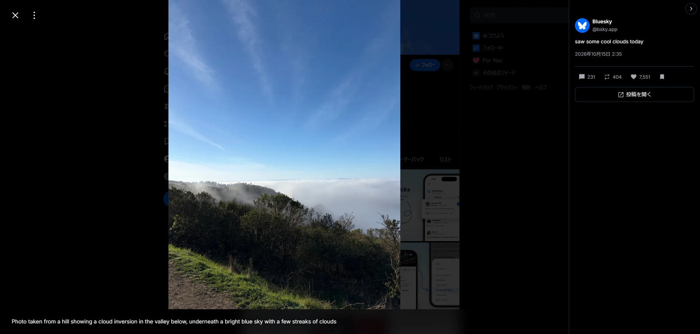
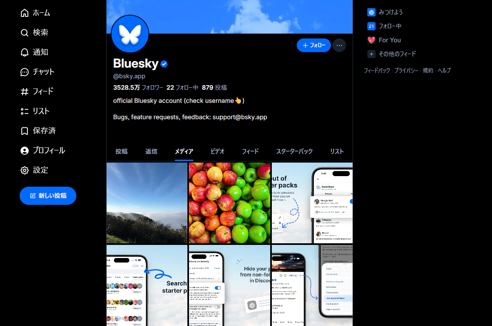
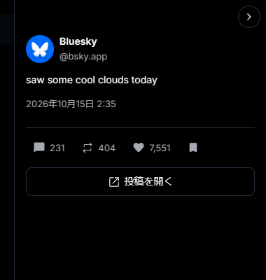

<div align="center">


# XViewer for Bluesky

**Bluesky のプロフィールのメディアをサムネイルの格子で一覧でき、画像を開いたまま投稿情報の確認や返信・いいねができるブラウザ拡張機能**

[](package.json)
[](LICENSE)


**[紹介サイト](https://xvbluesky.neonsdesign.com/)** ・
[プライバシーポリシー](https://xvbluesky.neonsdesign.com/privacy.html) ・
[English](README.en.md)

</div>

---

> [!IMPORTANT]
> **これは Bluesky (AT Protocol) の公開 API を利用して開発した非公式の拡張機能です。**
> **Bluesky Social PBC が作成・配布しているアプリケーションではありません。**
> 同社とは一切関係がなく、提携・支援・推奨を受けたものでもありません。
> 利用によって生じた一切の結果については、利用者自身が責任を負うものとします。

---

## これは何か

Bluesky のプロフィールのメディアタブが、**正方形のサムネイルを並べた格子**に変わります。
画像を開けば右側に本文・投稿日時・反応数と返信の一覧が並び、そのまま返信・リポスト・いいね・ブックマークまでできます。
画像そのものを押しても閉じないので、見ている途中で一覧へ戻されることもありません。



## 主な機能

### メディアグリッド



| | |
| --- | --- |
| **格子で一覧** | プロフィールのメディアタブを、AT Protocol の公開 API (`public.api.bsky.app` の `getAuthorFeed`) から取得したデータで、正方形のサムネイルを 3 列に並べた格子に置き換える。1 投稿 1 タイルで、複数枚の投稿は先頭の画像に枚数のアイコンを付ける。動画はビデオタブに任せて並べない |
| **続きの読み込み** | 下までスクロールしたときだけ続きを取得する。先読みはしない。別のアカウントへ移ると、前のアカウントの画像は残らない |
| **本体のライトボックスで開く** | タイルを押すと Bluesky 本体のライトボックスが開く。拡大や画像の送りは本体と同じ操作 |
| **NSFW のぼかし** | ラベルの付いた画像は本体と同じくぼかして表示する。設定で、格子のタイルに掛かるぼかしと警告文を外せる (既定はオフ。Bluesky 本体が出す警告には触れない) |

### ライトボックス

画像を開くと、右側に投稿情報のパネルが出ます。格子に限らず、bsky.app のどこで画像を開いても出ます。



| | |
| --- | --- |
| **投稿情報** | 作者・本文・投稿日時・返信 / リポスト / いいねの数と「投稿を開く」。本文のリンク・メンション・ハッシュタグも押せる。パネルは畳める |
| **開いたまま反応** | 返信・リポスト・引用・いいね・ブックマークを、画像を閉じずに行える。押した瞬間に表示が変わり、失敗したら元に戻して 1 行で知らせる。引用は本体の投稿画面をライトボックスの上に開く。ログインしていないときはボタンを出さない |
| **返信欄** | パネルの下に返信を新しい順に並べる (20 件ずつ)。「返信を表示」で返信への返信を 1 段だけ開く。上端の入力欄からその場で返信でき (Ctrl+Enter か「送信」、300 文字まで)、返信への返信もできる。返信に付いた画像はサムネイルで並び、押すとその画像に切り替わる (パネルもその返信のものになる)。返信の GIF は音なしで流れ (OS の動きを減らす設定がオンなら押して再生)、リンクカードと引用もカードで出る。返信の動画はサムネイルのカードで出て、押すとその場で再生できる。自分の返信は「削除」→「本当に削除？」で消せる。XViewer for Pixiv のコメント欄と同じ形 |
| **返信に画像を付ける** | 入力欄に画像を 10 枚まで付けられる (ボタンで選ぶ・貼り付け・入力欄へのドロップ)。4 枚までは通常の画像、5 枚以上はギャラリーとして送る。画像ごとに ALT 文と切り抜き、コンテンツの警告 (成人向け・生々しいメディア) を付けられる。投稿言語は 3 つまで選べ、選んだものは次の既定になる。返信先の言語が違うときは切り替えを提案する。絵文字の選択画面もある。画像は送る前に JPEG (長辺 4000px・2MB まで) に縮める |
| **GIF・リンクカード・引用** | GIF ボタンから Bluesky 本体と同じ GIF 検索 (KLIPY) で GIF を選んで付けられる。(ALT 文も付けられる。画像とは同時に付けられない) 本文に貼ったリンクはリンクカードになり、Bluesky の投稿の URL を貼るとその投稿の引用になる。画像・GIF と引用は一緒に送れる。本文のリンクは本体と同じく短い形で保存し、残りの文字数もその形で数える |
| **返信に動画を付ける** | 入力欄に動画を 1 本付けられる (画像と同じボタンで選ぶ・貼り付け・ドロップ。mp4・webm・mov・mpeg、300MB・10 分まで)。縮めずに元のファイルのまま送り、付けた時点でアップロードが始まる。「動画を送信中」「動画を処理中」の進み具合が出て、処理が終わるまで送信できない。ALT 文と字幕 (.vtt を 1 本、20KB まで。言語つき) を「字幕と ALT」の画面で付けられる。動画は画像・GIF とは同時に付けられず、引用とは一緒に送れる |
| **スレッドで返信する** | 入力欄の「＋」(スレッドに他の投稿を追加) で続きの投稿を足し、10 件までをまとめて 1 回で送れる。投稿ごとに画像・動画・GIF・リンクカード・引用・コンテンツの警告を付けられ、投稿言語は全体で 1 つ。ツールバーは書いている投稿の下に出る。2 件以上のときは「×」で投稿を消せる。(中身があれば「本当に削除？」を聞く) 途中の空の投稿は、聞いてから飛ばして送る。送った返信は一覧の中でつながって並ぶ |
| **画像を押しても閉じない** | 画像そのものを押してもライトボックスを閉じず、押せるボタンの上でだけカーソルが指の形になる。周りの暗い部分を押せば閉じる。閉じるボタンを左上に移し、画像オプションをその右に並べる |

認証は Bluesky 本体がページの中に持っている認証済みのクライアントを借りるだけで、`localStorage` のトークンには触れません。
借りたクライアントで通せるのは、自分のいいね・リポスト・ブックマークの付け外し、投稿と返信の一覧の取得、返信に付ける画像のアップロード (JPEG・PNG・WebP・GIF の 2MB まで)、返信に付ける字幕 (.vtt の 20KB まで) のアップロード、返信に付ける動画の `video.bsky.app` へのアップロード、自分の返信の投稿 (10 件までの返信の連なりをまとめて送るものを含む) と削除だけに絞ってあります。
返信でない投稿は作れず、返信に付けられるのは画像・動画・GIF・リンクカード・投稿の引用とコンテンツの警告だけです。動画のアップロードで使う認証は、ページの中の本体のクライアントの中だけで作って使い、拡張機能の他の部分には渡しません。消す前には相手が自分の返信であることを確かめます。

### そのほか

| | |
| --- | --- |
| **ナビゲーションボタン** | プロフィールの右下に「ビデオへ / メディアへ / 投稿へ / ページ先頭へ」の固定ボタンを出す。今いるタブのボタンは隠れ、スクロールすると「ページ先頭へ」が出る |
| **デバッグモード** | タブ判定・格子の起動と撤去・取得の状況をコンソール (`[XViewer][debug]`) に出し、内部状態を `html` 要素の `data-bsky-ext-state` 属性に書き出す (既定はオフ) |
| **テーマ** | パネルの配色は Bluesky 本体のダーク / ディム / ライトに追従する。設定画面は自分で切り替えられる |

## 対応ブラウザ

Manifest V3 に対応した Chromium 系ブラウザ。(Chrome / Brave / Edge など)**Chrome 120 以上**が必要です。
(コンテンツスクリプトの `"world": "MAIN"`、`color-mix()`、CSS nesting を使っています)
Firefox (Firefox 140 以上) 向けにもビルドできますが、一時的なアドオンとしての読み込みで、動作はまだ十分に確かめていません。
Safari には対応していません。

## 対応言語

拡張機能の表示 (ポップアップ・パネル・ボタン) は今のところ**日本語だけ**です。
Bluesky 本体をどの言語で表示していても動作しますが、拡張機能が足した部分は日本語で表示されます。

## インストール

ストアでの配布はまだありません。次のどちらかの方法で読み込んでください。

### 配布用の zip から

1. [Releases](https://github.com/NEONS-DESIGN/XViewer-for-Bluesky/releases/latest) から最新版の `XViewer.for.Bluesky_x.y.z.zip` をダウンロードして展開する
2. `chrome://extensions/` を開く (Brave は `brave://extensions/`、Edge は `edge://extensions/`)
3. 右上の **デベロッパーモード** をオンにする
4. **パッケージ化されていない拡張機能を読み込む** を押す
5. 展開したフォルダを選ぶ

新しい版にするときは、同じフォルダへ上書きで展開し、拡張機能のカードの再読み込みボタンを押してから bsky.app のタブを再読み込みしてください。
展開したフォルダを消すと、拡張機能も読み込めなくなります。

### ソースからビルドして

Node.js 24.2 以上が要ります。

```bash
git clone https://github.com/NEONS-DESIGN/XViewer-for-Bluesky.git
cd XViewer-for-Bluesky
npm install
npm run build
```

**Chrome 系**

1. `chrome://extensions/` を開く
2. 右上の **デベロッパーモード** をオンにする
3. **パッケージ化されていない拡張機能を読み込む** を押す
4. 生成された **`dist/`** フォルダを選ぶ

`src/` やリポジトリのルートではなく `dist/` を選んでください。ビルド後の成果物だけが動きます。

**Firefox**

1. `about:debugging` を開き、**この Firefox** を選ぶ
2. **一時的なアドオンを読み込む** で **`dist-firefox/manifest.json`** を選ぶ

一時的なアドオンは Firefox を閉じると外れます。

## 使い方

bsky.app の**プロフィール** (`https://bsky.app/profile/{handle}`) を開き、右下の「メディアへ」を押すか、メディアタブを開くだけです。
投稿情報のパネルは、bsky.app のどこで画像を開いても出ます。(ホーム・投稿のページ・検索結果など)

### 設定

ツールバーのアイコンから開きます。「設定」と「ライセンス」の 2 つのタブがあり、設定はセクションごとにスイッチでオンとオフを切り替えられます。
変更はリロードせずにその場で反映されます。
`↳` の付いた項目は上の項目の子です。親の項目がオフの間は、その項目を操作できません。(押すと理由を表示します)
子の設定は保たれ、親をオンに戻すと元の状態に戻ります。
「ライセンス」タブには免責事項と、同梱している第三者の成果物の表示が並びます。

| 区分 | 項目 | 既定 | 効果 |
| --- | --- | --- | --- |
| メディアグリッド | メディアグリッド表示 | オン | プロフィールのメディアタブを、正方形のサムネイルの格子に置き換える。オフにすると Bluesky 本体の表示に戻る |
| メディアグリッド | ↳ NSFWのぼかしを解除 | オフ | 格子のタイルに掛かるぼかしと警告文を外し、1 回の押下で開けるようにする。Bluesky 本体が出す警告には触れない |
| ライトボックス | 投稿情報を表示 | オン | 画像を開いたとき、右側に本文・投稿日時・反応数を並べる。格子以外の画像でも動く。ウィンドウの幅が狭いときは出さない |
| ライトボックス | ↳ 返信・いいね | オン | パネルに返信・リポスト・引用・いいね・ブックマークのボタンを出す。オフにするとボタンだけが消え、パネルは残る |
| ライトボックス | ↳ 返信の一覧 | オン | パネルの下に返信の一覧を出す。「返信・いいね」もオンなら、入力欄から返信 (画像・動画・GIF・リンクカード・引用も付けられる) したり自分の返信を消したりできる |
| ライトボックス | 画像のクリックで閉じない | オン | 画像そのものを押しても閉じないようにし、押せるボタンだけにカーソルの形を残す。閉じるボタンを左上に移し、画像オプションをその右に並べる |
| 開発者向け | デバッグモード | オフ | タブの判定・格子の起動と撤去・取得の状況をコンソールに出し、内部状態を `html` 要素の属性に書き出す。不具合を報告するときに使う |

設定画面の配色は、右上のボタンからダーク / ライトを切り替えられます。初期状態は OS の設定に従い、
一度切り替えると以後はその配色で固定されます。(「設定を初期化」で OS 追従に戻ります)
「設定を初期化」は、確認のうえ全項目と配色を既定に戻します。

## 注意事項

- **これは非公式の拡張機能です。** Bluesky (AT Protocol) の公開 API を利用して開発したもので、
  Bluesky Social PBC が作成・配布しているアプリケーションではありません。同社とは一切関係がありません
- **利用は自己責任です。** この拡張の利用によって生じた損害について、作者および Bluesky Social PBC は責任を負いません
- **いいね・リポスト・ブックマークは、押した分だけあなたのアカウントで Bluesky へ送られます。**
  いいねとリポストは、Bluesky 本体から操作したときと同じく公開されます
- **返信は、パネルの入力欄か Bluesky 本体の投稿画面であなたが送信したときだけ投稿されます。** 添付した画像と、リンクカード・GIF のサムネイルも、そのときにだけあなたのアカウントのサーバー (PDS) へアップロードされます。添付した動画は、付けた時点で Bluesky の動画サービス (`video.bsky.app`) へアップロードされ、変換された結果が返信に付きます。(送信しなくても、付けた動画はアップロードされます。外すか入力欄を閉じると途中で止めます)リポストのボタンの「引用する」は本体の投稿画面を開きます。
  拡張機能が消せるのは、あなたが「本当に削除？」まで押した自分の返信だけです。返信でない投稿の作成と削除・フォロー・ブロック・DM の送信は行いません
- **GIF の検索とリンクカードには、Bluesky 本体と同じ中継サービスを使います。** GIF の画面に入力した検索語 (とブラウザの言語の地域) は `gifs.bsky.app` へ、入力欄の本文にあるリンクの URL はカードを作るために `cardyb.bsky.app` へ送られます。GIF の画像・動画は `static.klipy.com` / `k.gifs.bsky.app` / `t.gifs.bsky.app` から読み込みます。どれもあなたが GIF の画面を開いたとき・入力欄にリンクを書いたとき・返信の一覧に GIF やカードがあるときだけです
- **返信の一覧の動画の再生には、Bluesky の動画サービスを使います。** 動画のカードを押したときだけ、`video.bsky.app` から再生リストと動画を読み込みます。(サムネイルはカードを表示するときに読み込みます)
- **NSFW のぼかしの解除は、格子のタイルだけが対象です。** Bluesky 本体のコンテンツの表示設定や、本体が出す警告は変えません
- **画像を収集する機能はありません。** ダウンロード機能も一括操作の自動化もありません。
  取得するのは、いま見ているプロフィールの投稿と、開いた画像の投稿だけです
- **取得は下までスクロールしたときだけで、先読みはしません。** 公開 API への問い合わせは、
  一定の間隔を空けて 1 回ずつ行います
- **Bluesky の仕様変更で動かなくなることがあります。** 本体の画面の作りが変わると、格子やパネルが出なくなる場合があります
- ラベラーアカウント (メディアタブを持たないアカウント)、ログインしていない状態、スマートフォンの幅の画面では、まだ動作を確かめていません

## バグ報告・質問・リクエスト

不具合の報告、使い方の質問、機能のご要望は **[Issues](https://github.com/NEONS-DESIGN/XViewer-for-Bluesky/issues)** へお寄せください。
不具合のときは、ポップアップの「デバッグモード」をオンにして、コンソールに出た内容を添えていただけると原因を探しやすくなります。
(貼る前に、ご自身のアカウントの識別子などが含まれていないかを確かめてください)

## 開発

| コマンド | 内容 |
| --- | --- |
| `npm run build` | Chrome 系用の `dist/` と Firefox 用の `dist-firefox/` を作る |
| `npm run build:chrome` / `npm run build:firefox` | 片方だけを作る |
| `npm run watch` | ビルドの監視モード (JS のみ。CSS・HTML・アイコンを変えたときは `npm run build`) |
| `npm test` | `node --test` でテストを走らせる |
| `npm run build:icons` | 拡張機能アイコンの PNG を生成する (生成物はコミット済み) |
| `npm run build:symbols` | ポップアップとパネルのアイコン図形データ (`src/common/icon-shapes.js`) を Material Symbols から生成する (生成物はコミット済み) |
| `npm run build:site-langs` | 紹介サイトの全ページの言語の一覧 (hreflang / 言語メニュー / フッター) と `site/sitemap.xml` を `scripts/site-langs.mjs` の表から書き直す |

ソースは `src/` に ES Modules で置き、esbuild で束ねて出力します。実行時の依存は返信欄の絵文字の選択画面に使う `emoji-mart` と `@emoji-mart/data`、返信の一覧の動画の再生に使う `hls.js` だけで、
絵文字の選択画面のページ (`dist/emoji/`) と動画の再生の束 (`dist/video/`) にだけ入ります。(パネルの content script からは iframe や、動画を押したときの読み込みで使うだけで、`content.js` には入りません)
バージョンの出どころは `package.json` の `version` だけで、ビルドが `dist/manifest.json` と `dist-firefox/manifest.json` へ差し込みます。
対応するブラウザの下限 (esbuild の target、`minimum_chrome_version`、Firefox の `strict_min_version`) の出どころは `scripts/targets.mjs` です。

コードを変更したら、次の 3 つを必ず行ってください。どれかを忘れると、変更が効いていないように見えます。

1. `npm run build` を走らせる
2. 拡張機能のカードの再読み込みボタンを押す
3. bsky.app のタブを再読み込みする (`inject.js` はページ側のワールドで動くため、タブを再読み込みしない限り新しい版が入らない)

テストは Node の組み込みテストランナー (`node:test`) だけを使います。対象は解析・整形・判定の純関数、
ポップアップ (偽 DOM での描画を含む)、ビルドの道具です。content script の DOM 操作・本体レイアウトへの介入・
橋渡しは、実機の bsky.app で確かめます。

拡張機能アイコン (`src/icons/`) は `npm run build:icons` の生成物です。画像編集ソフトで直接触らず、
`scripts/icon-svg.mjs` の `GEOMETRY` を直して生成しなおしてください。地の色はポップアップのアクセント色と同じです。

`site/` は[紹介サイト](https://xvbluesky.neonsdesign.com/)の実体です。ビルド工程はありません。
`main` へ push すると `.github/workflows/pages.yml` が `site/` だけを GitHub Pages へ公開します。
ローカルでの確認は `python -m http.server 8000 --directory site` で `http://localhost:8000/` を開いてください。
(`file://` で開くと `en/` が `en/index.html` に解決されません)
言語の一覧は各ページに直書きせず、`npm run build:site-langs` で書き直します。目印 (`<!-- lang:head -->` など) を消さないでください。

[XViewer for Pixiv](https://github.com/NEONS-DESIGN/XViewer-for-Pixiv) は姉妹プロジェクトで、ビルドの方式とポップアップの作りを共通にしています。

## ライセンス

[MIT License](LICENSE)

同梱している第三者の成果物 (Material Symbols・Emoji Mart・hls.js) については [`NOTICE`](NOTICE) を参照してください。hls.js は Apache License 2.0 で同梱しています。Apache License 2.0 と Emoji Mart の MIT License の本文は [`LICENSES/`](LICENSES) に同梱しています。
